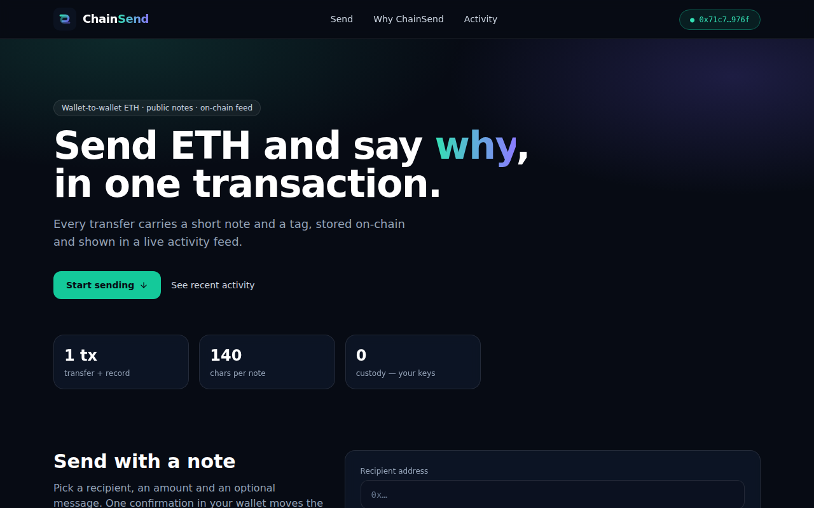
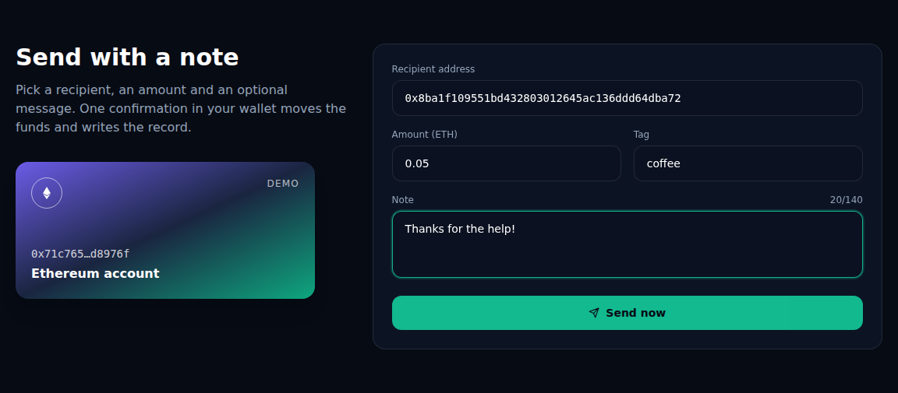
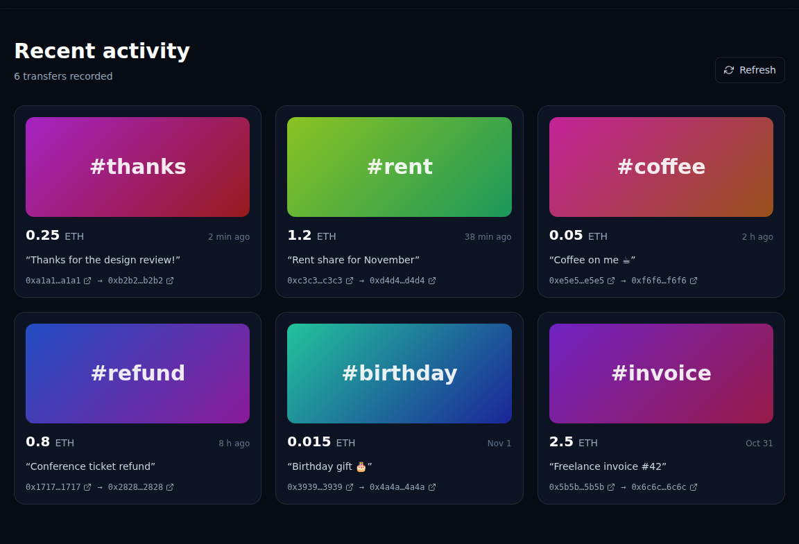
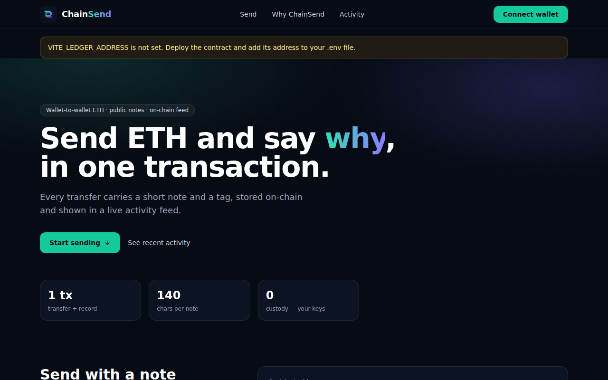
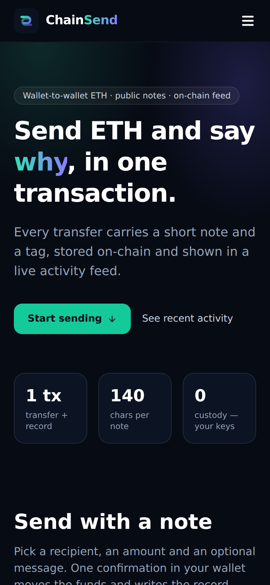
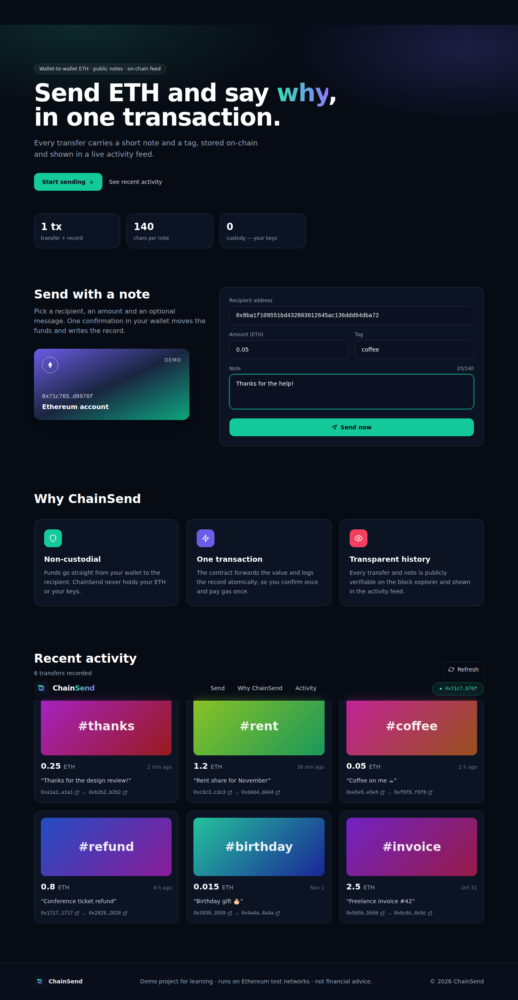
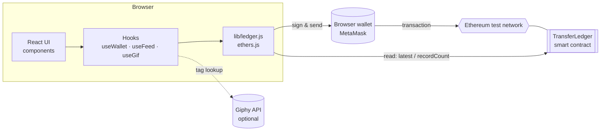
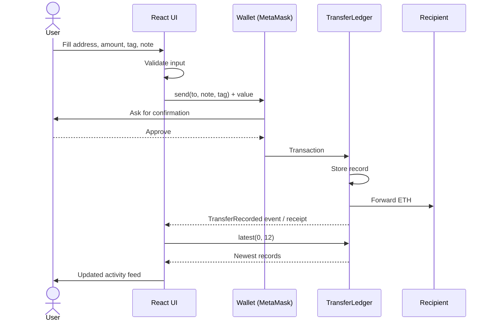
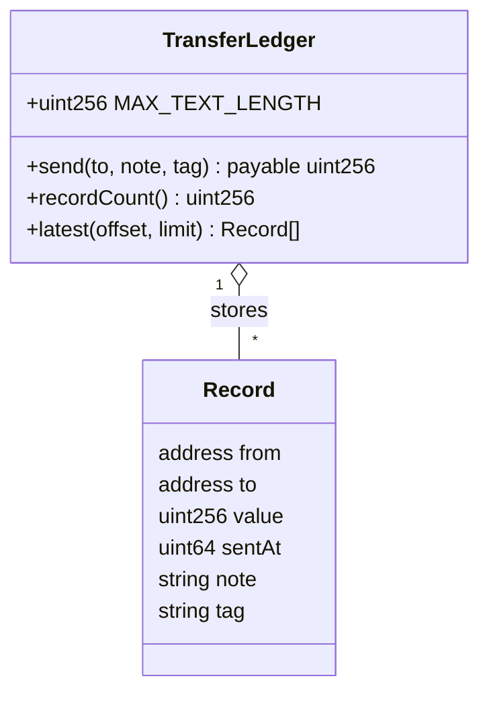

<div align="center">


# ChainSend

**Send ETH with a public note and tag — transfer and record in a single transaction**




</div>

---

## Overview

ChainSend is a dApp that lets a user connect a browser wallet, send ETH to any address, and attach a short **note** and **tag** to the payment. The `TransferLedger` contract forwards the funds and stores a record in the same transaction, and the UI renders those records as a live, newest-first activity feed

| Feature | Description |
| --- | --- |
| One-step payments | Value is forwarded and logged atomically — one confirmation, one gas payment |
| Notes & tags | Up to 140 characters each, validated on the client and in the contract |
| Activity feed | Paged, newest-first list read directly from the contract |
| Network guard | Warns when the wallet is on a different chain than the configured one |
| Demo mode | Run the whole UI with sample data and no wallet (`VITE_DEMO=true`) |
| Optional GIFs | Tag-based GIF previews when a Giphy key is supplied; generated gradients otherwise |

## Screenshots

| Send form | Activity feed |
| :---: | :---: |
|  |  |

| Wallet not connected | Mobile |
| :---: | :---: |
|  |  |

<details>
<summary>Full-page view</summary>



</details>

## Architecture



### Send flow



### Data model



## Project structure

```text
chainsend/
├── contracts/
│   └── TransferLedger.sol      # Solidity contract
├── scripts/
│   ├── compile.mjs             # solc-js compile → src/contracts/*.json
│   └── deploy.mjs              # deploy using RPC_URL + DEPLOYER_KEY from .env
├── test/
│   └── ledger.test.mjs         # contract tests on an in-process chain
├── src/
│   ├── components/             # Header, Hero, SendPanel, Features, ActivityFeed, Footer …
│   ├── hooks/                  # useWallet, useFeed, useGif
│   ├── lib/                    # config, format helpers, ledger (contract access), demo data
│   ├── contracts/              # generated ABI + bytecode
│   ├── styles/index.css        # Tailwind layers + component classes
│   ├── App.jsx
│   └── main.jsx
├── docs/images/               # README screenshots
├── public/logo.svg
├── .env.example
└── vite.config.js · tailwind.config.js · postcss.config.js
```

## Getting started

**Requirements:** Node.js 18+, a browser wallet such as MetaMask, and a funded **test-network** account.

```bash
# 1. install
npm install

# 2. configure
cp .env.example .env        # then fill in the values (see Configuration)

# 3. compile and test the contract
npm run compile
npm run test:contract

# 4. deploy to a test network and copy the printed address into VITE_LEDGER_ADDRESS
npm run deploy

# 5. run the app
npm run dev                 # http://localhost:5173
```

Want to look around without a wallet or a deployed contract?

```bash
VITE_DEMO=true npm run dev
```

## Configuration

| Variable | Used by | Purpose |
| --- | --- | --- |
| `VITE_LEDGER_ADDRESS` | App | Address of the deployed `TransferLedger` |
| `VITE_CHAIN_ID` | App | Expected chain (default `11155111`, Sepolia) |
| `VITE_EXPLORER_URL` | App | Block explorer base URL for address links |
| `VITE_GIPHY_KEY` | App (optional) | Enables GIF previews for tags |
| `VITE_DEMO` | App | `true` = sample data, no wallet |
| `RPC_URL` | Deploy script | JSON-RPC endpoint |
| `DEPLOYER_KEY` | Deploy script | Private key of a **test** account |

Anything prefixed with `VITE_` is bundled into the browser build — never put secrets there

## Smart contract

| Function | Description |
| --- | --- |
| `send(address to, string note, string tag)` `payable` | Forwards `msg.value` to `to`, stores a record, emits `TransferRecorded` |
| `recordCount()` | Number of stored records |
| `latest(uint256 offset, uint256 limit)` | Newest-first page of records |

Custom errors: `ZeroAddress`, `NoValue`, `TextTooLong`, `ForwardFailed`

## Security notes

- Keep `.env` out of version control (already in `.gitignore`) and use throw-away keys on test networks only
- The contract is unaudited and intended for learning. Do not deploy it with real funds without a professional review
- Notes and tags are public and permanent once written to the chain
